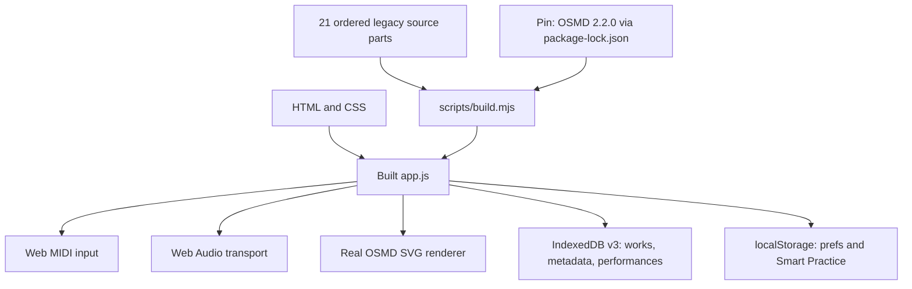

# Play Along — architecture and development plan

**Current version:** v0.10.51 (FG-03C2B1 review branch; only merged changes deploy to production). The production GitHub Pages site is rebuilt and tested automatically from `main`.

## Current implementation

The 21 JavaScript fragments are concatenated in `scripts/manifest.json` order to create one shared-lexical-scope IIFE. Some code functions are split across adjacent fragments, and some older functions are intentionally overridden later in the bundle. This is a working transitional architecture, **not** independent ES modules. All source reordering is high-risk until boundaries are refactored.

## Data and reliability

- IndexedDB v3 stores original imported music in `works`, a metadata-only `workIndex`, and untruncated `performances`. Existing v1/v2 data is migrated transactionally.
- Per-song practice settings and the selected score are restored at startup; MIDI device preferences are global.
- Backup JSON is explicitly user-exported, checked against typed settings schema and music content IDs before import, and uses a single IDB transaction to commit binary files, favourites and history. localStorage updates occur before that transaction; failures roll back the cache.
- GitHub Actions uses locked npm dependencies, deterministic build checks and real Chromium tests for OSMD, MusicXML, MIDI Wait, persistence, quota safety and backup XSS.
- Browser storage is origin-specific; clearing site data removes the local repertoire unless the user has kept a backup.

## Music invariants

1. One Web Audio transport clock governs audio, Piano Roll and the OSMD cursor.
2. A new physical NoteOn may advance Wait legato; a held note may not be credited repeatedly.
3. Tempo and Wait must count simultaneous unison voices from one physical key press; duration judgement is per written voice.
4. Playback notes, time maps, notation cursor and rehearsal position must agree after repeats, meter changes and tempo offsets.
5. Unsupported navigation must report limitations instead of claiming correct playback.

## Finger Guidance roadmap — October 2026

The evidence-gated feature roadmap is maintained in [docs/ROADMAP-FINGER-GUIDANCE.md](docs/ROADMAP-FINGER-GUIDANCE.md). The player already has the fourteen original PNG poses, MusicXML author fingering and next-task guidance. FG-03A adds the pure deterministic `src/core/finger-guidance-timeline.mjs` to preserve **all valid score onsets**, including unannotated notes, as forecast boundaries. Incomplete chords show only verified numeric labels, not a falsely complete hand pose. The same core module runs in Node tests and is included in the transitional browser bundle.

Research-only FG-02 automatic fingering stays **NO-GO for learner instruction**: independent PianoVAM results show 644 source-matching labels of 1,467 eligible notes (43.90%), with 82.48% proposal coverage and only 5.53% annotation coverage of original notes. This measures source agreement, not independently certified ergonomic technique. The source data is CC BY-NC-SA 4.0 and is not bundled into Play Along.

FG-03B1 adds a pure, tempo-scaled, loop-aware `fingerGuidanceGhostWindow()` and a validated 500–1000 ms preparation preference (default 750 ms). It gates **only the secondary semitransparent preview**, not the actionable next unfinished note; Wait suppresses premature second-hand preview. FG-03B2A now adds a pure smoothstep `fingerGuidanceMotionPlan()` on the **secondary PNG only**, and `fingerGuidanceHandsCross()` prevents visually simulating unverified crossed-hand paths. Fixed future piano-key badge geometry, no persisted movement state, and explicit clipped-image refusal are architecture invariants. FG-03B2B-1 adds a real Chromium 25/49/61/88-key x desktop/mobile screenshot and geometry matrix. A virtual target range is now a valid visible keyboard even with no MIDI profile; display changes force a real canvas geometry rebuild. A hand pose must not be registered to a **subset** of the authored chord when another source finger is outside the viewport. FG-03B2B-2 was confirmed **accepted by a pianist** by the project owner on 2026-10-12; detailed musician evaluation artifacts were not supplied. This acceptance covers the reviewed hand-guidance phase, not the research-only automatic fingering engine. FG-03C1 introduces the pure `musicXmlSourceNoteId()` core and preserves every written tie segment's identity (`sourceNoteIds`), even when playback merges them into a single sustained sound. Deterministic part/measure/ordinal IDs distinguish duplicate part names and concurrent unisons, independent of rendered track, tempo and transposition. FG-03C2A now layers separately validated per-note user fingering records over original MusicXML in the piano-roll renderer; canonical source IDs, score-key checks, bounded single-level undo, source reset, and strict backup/legacy settings normalization maintain provenance. Browser storage writes are attempted before the live correction is committed. FG-03C2B will extend multi-step undo/redo, cross-edition reconciliation and annotated MusicXML export; future experimental Worker predictions require independent pianist validation before learner-facing use.

## Existing reliability and architecture milestones

1. Build normalized musical event and bar-timeline data models with isolated unit tests and reference MusicXML fixtures.
2. Replace conservative repeat/volta guards with verified restoration of divisions, time signatures, key and tempo state at each jump. Add D.C./D.S./coda in separately tested increments.
3. Extract standalone ES modules beginning with parsers, serialization/storage and pure time conversion; then transport and MIDI.
4. Add stress/long-score profiling, physical Web MIDI acceptance, CC64 pedal behavior and representative score samples from every catalog.
5. Strengthen recovery under multi-tab concurrency and extremely large collections; consider a streamed backup format.

License and provenance restrictions for online catalogs and bundled assets remain in force.

## First extracted pure module — v0.10.16

`src/core/music-time.mjs` is the single-source-of-truth for tick↔seconds and beat↔seconds conversion. It is imported directly by `tests/music-time.test.mjs`; `scripts/build.mjs` mechanically strips named `export` keywords and includes the same source in the beginning of the existing IIFE. MusicXML, SMF and the OSMD cursor use the exact same code. This intentionally avoids attempting to migrate the legacy app bootstrap to ESM in one step; later components can be extracted behind tested interfaces.

## Normalized bar-grid module — v0.10.16

`src/core/music-bars.mjs` defines the canonical, DOM-independent measure-span and bar-start model in quarter-note coordinates. XML reading remains in the legacy adapters; those adapters normalize each score measure to `{beats,beatType,occupied,implicit}` descriptors. The same pure implementation is used for multi-part downbeats, per-part fallback and OSMD bar navigation. The source is directly importable by Node and embedded once in the existing browser bundle.
## Library v0.10.49 — source fidelity and movable sections

Library results are assembled from saved IndexedDB workIndex metadata, connected-folder file descriptors and public catalog descriptors. Public/unopened scores are **not** inspected on listing and must display **unknown**, never a fabricated "no fingering" verdict. Lightweight `fingeringCoverage` counters are written to `workIndex` after real score parsing; the binary `works` store remains unchanged. Existing v3 works progressively backfill missing metadata, and manual canonical note overrides update counters. Only author/explicit-user finger markings count as score coverage, not FG-02 research proposals. Strict `librarySections` state validation prevents malformed order/closure maps in backups.

The five library panels are moved as live DOM nodes (not recreated) under the single `#librarySections` sortable stack. A compact accessible accordion heading provides DnD, move buttons, keyboard alternative and validated persisted ordering. The dedicated Library screen deliberately uses a single column to honor arbitrary ordering of **Catalog itself**; search remains outside the rearrangeable stack, and the catalog has a bounded scroll. [Detailed contract](docs/LIBRARY-COVERAGE-AND-LAYOUT.md).
## Library v0.10.50 — sixth panel without settings regression

The previous five-panel `librarySections` order is accepted as a valid legacy payload even in strict backup restore, and upgraded by appending `quick`, preserving existing user order and collapsed flags. New records require exactly six distinct panel IDs. Quick Actions shares existing live-DOM organizer and does not recreate its calibration/reset handlers. [Library details](docs/LIBRARY-COVERAGE-AND-LAYOUT.md).
## FG-03C2B1 multi-step source-correction history (v0.10.51)

`src/core/finger-override-history.mjs` implements pure 40-deep Undo/Redo state transitions. In the runtime, stacks are partitioned by canonical MusicXML source fingerprint and capped at 12 active workbooks. The only persistent data is the validated `fingerOverrides` map. An edit/undo/redo first validates against the current score ID and the expected stored per-note value, then writes prospective preferences to localStorage before committing the in-memory history and refreshing guidance, allowing storage/quota errors to leave state unchanged. After reload/reimport, user corrections persist but the ephemeral undo/redo sequence is empty. No authored XML or source notes are changed. [Engineering contract](docs/FG-03C2B1-UNDO-REDO.md).
