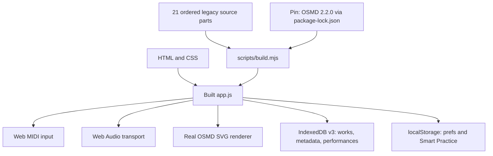

# Play Along — architecture and development plan

**Current version:** v0.10.13. The production GitHub Pages site is rebuilt and tested automatically from `main`.

## Current implementation

The 21 JavaScript fragments are concatenated in `scripts/manifest.json` order to create one shared-lexical-scope IIFE. Some code functions are split across adjacent fragments, and some older functions are intentionally overridden later in the bundle. This is a working transitional architecture, **not** independent ES modules. All source reordering is high-risk until boundaries are refactored.

## Data and reliability

- IndexedDB v3 stores original imported music in `works`, a metadata-only `workIndex`, and untruncated `performances`. Existing v1/v2 data is migrated transactionally.
- Per-song practice settings and the selected score are restored at startup; MIDI device preferences are global.
- Backup JSON is explicitly user-exported, checked against typed settings schema and music content IDs before import, and uses a single IDB transaction to commit binary files, favourites and history. localStorage updates occur before that transaction; failures roll back the cache.
- GitHub Actions uses locked npm dependencies, deterministic build checks and real Chromium tests for OSMD, MusicXML, MIDI Wait, persistence, quota safety and backup XSS.
- Browser storage is origin-specific; clearing site data removes the local repertoire unless the user has kept a backup.

## Music invariants

1. One Web Audio transport clock governs audio, Piano Roll and the OSMD cursor.
2. A new physical NoteOn may advance Wait legato; a held note may not be credited repeatedly.
3. Tempo and Wait must count simultaneous unison voices from one physical key press; duration judgement is per written voice.
4. Playback notes, time maps, notation cursor and rehearsal position must agree after repeats, meter changes and tempo offsets.
5. Unsupported navigation must report limitations instead of claiming correct playback.

## Next milestones

1. Build normalized musical event and bar-timeline data models with isolated unit tests and reference MusicXML fixtures.
2. Replace conservative repeat/volta guards with verified restoration of divisions, time signatures, key and tempo state at each jump. Add D.C./D.S./coda in separately tested increments.
3. Extract standalone ES modules beginning with parsers, serialization/storage and pure time conversion; then transport and MIDI.
4. Add stress/long-score profiling, physical Web MIDI acceptance, CC64 pedal behavior and representative score samples from every catalog.
5. Strengthen recovery under multi-tab concurrency and extremely large collections; consider a streamed backup format.

License and provenance restrictions for online catalogs and bundled assets remain in force.
