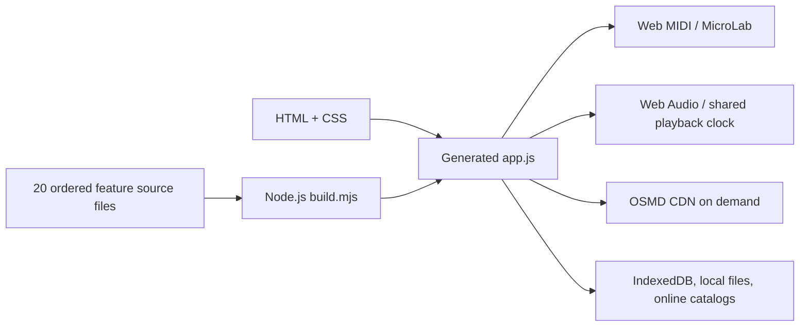

# Play Along architecture and migration plan

## Current v0.10.0 architecture

The code is **not** independent ES modules yet. Feature-oriented pieces are concatenated into the preserved IIFE because functions currently reference each other via lexical shared state (`state`, `current`, `pos`, `ctx`, etc.).

This is deliberate migration staging: minimal behavioral risk for the first release, easy source navigation and reproducible build. It is not equivalent to removing global coupling. The build manifest order is significant.

## Recommended next milestones

1. **Extract pure data parsers**: MIDI parser, MusicXML/MXL reader, MusicScore reader and validation into importable ES modules with file-based fixtures; preserve the existing output structures.
2. **Separate catalog clients**: Mutopia, MuseTrainer, ASAP each behind a common `SearchResult` / `SongAsset` interface. Normalize provenance and license metadata in one place.
3. **Introduce an explicit transport clock API** with one source of truth for tempo, position, note-on/off and audio scheduling, used by Piano Roll and OSMD cursor. Remove duplicate cursors and implicit global state.
4. **Web MIDI adapter**: discovery/permission, disconnect and reconnect, note deduplication, sustain pedal handling; a fake input for automated tests and USB hardware acceptance.
5. **OSMD offline dependency**: verify a pinned OSMD package and vendored build, test original MusicXML + synthetic MIDI transcription side by side, then remove CDN reliance.
6. **Add CI** for Node parser tests, Playwright smoke on an unrestricted runner, and regression fixtures for Wait, simultaneous chords and rests.

## Non-regression invariants

- One Web Audio transport governs both Piano Roll and Sheet Music.
- In Wait, a single held physical key must not advance multiple successive note groups.
- Existing IndexedDB and localStorage schemas are retained until explicit migration code exists.
- Original notation is used for MusicXML; notes inferred from MIDI remain clearly labeled approximate.
- Online sources never become silently bundled into the app without review of licenses, even though Play Along is noncommercial.
